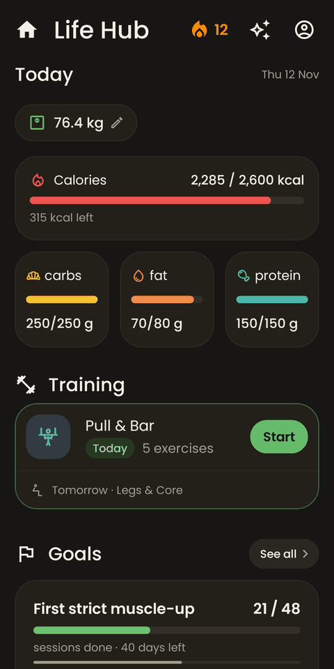
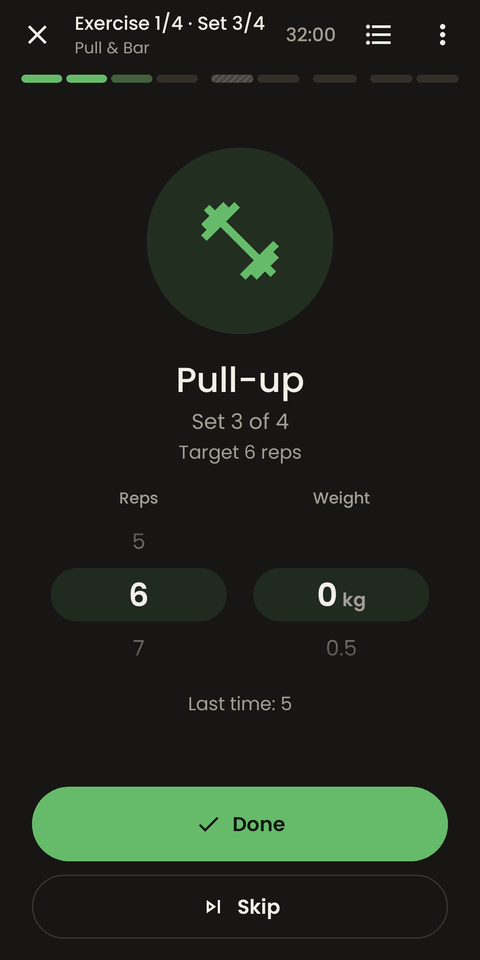
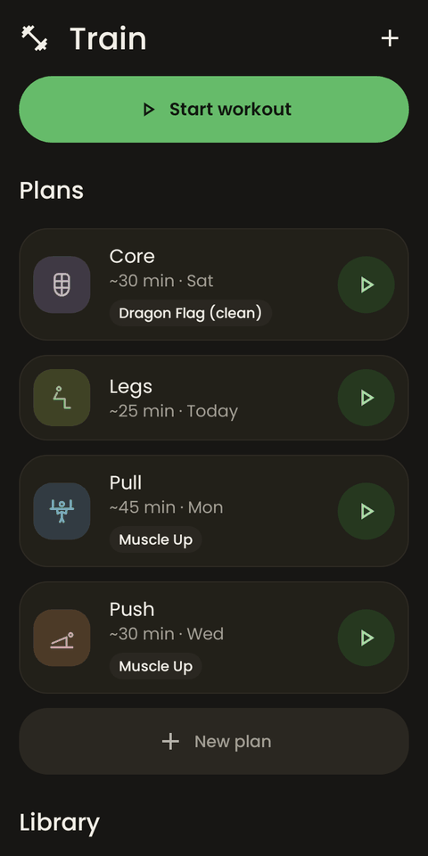
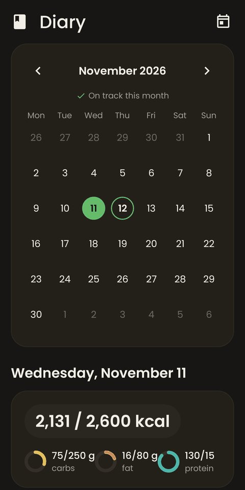
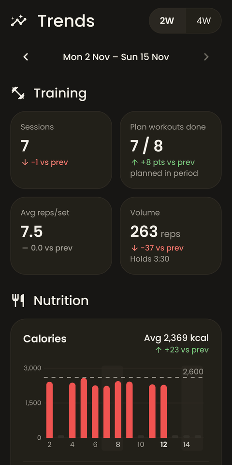
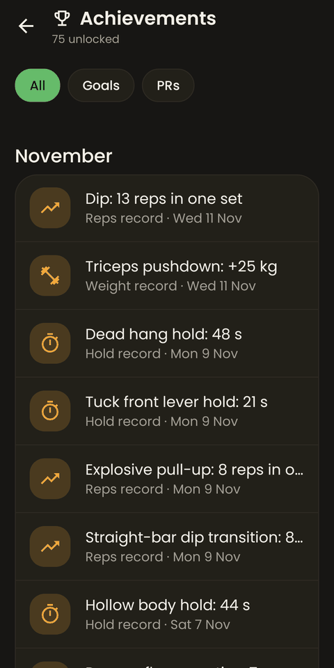
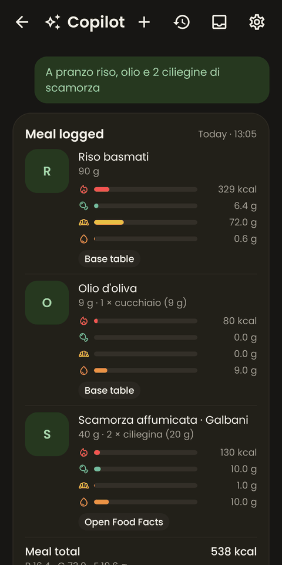
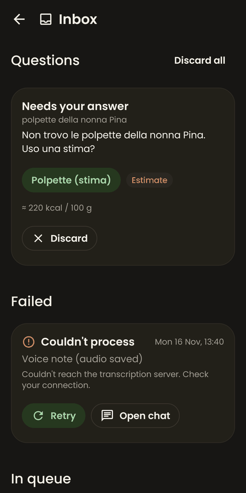
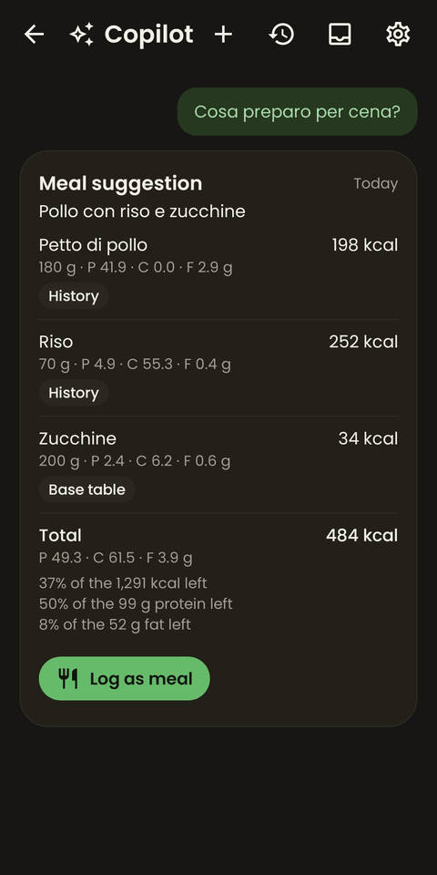
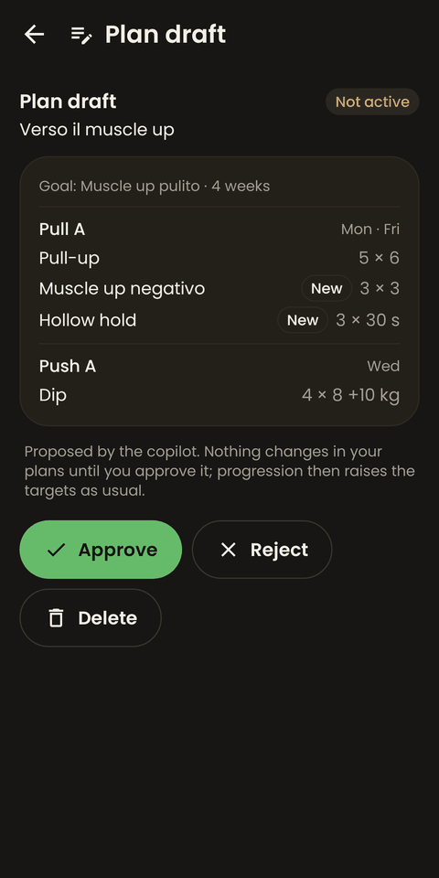

# FitLife Hub

A local-first Android app for calisthenics training, food logging and body tracking, with an optional LLM copilot that logs meals and weight from text or voice.

FitLife Hub is a personal project built with Kotlin, Jetpack Compose and Room. It brings workout plans, a live workout mode, a food diary, weight tracking, goals and achievements into one app, with no accounts and no cloud backend. Your data stays in a Room database on the phone. The **Fitness Copilot** is opt-in: it talks to a language model of your choice using your own API keys, and it can only act through the app's own tools, so every number it shows comes from your diary.

> The UI is in English. The copilot understands and replies in **Italian**.

## Features

### Train
- **Workout plans** with an ordered exercise list, weekdays, sets, and a target per set (reps, max reps, or seconds), plus rest time and optional added weight. Plans can be duplicated and linked to goals.
- **Exercise library** with custom exercises, search and category filters.
- **Live workout (focus mode)**: one set at a time on a full screen, wheel pickers for reps and weight, "last time" hints, an automatic rest countdown (±15 s, skip) and an isometric hold timer. You can skip, add or remove sets and exercises on the fly. Progress is saved to the database on every change, so a session survives process death and can be resumed.
- **Finish summary** with sets, volume, holds, new records, RPE and notes. Past workouts can be logged manually from the diary.

### Eat
- **Food diary** per day: search foods (bundled base table of common foods and Open Food Facts), **scan a barcode**, create custom foods, or use **Quick add** for kcal and macros.
- Portions, package sizes and household measures (for example "1 cucchiaio").
- Daily kcal and macro totals against your targets (carbs, fat, protein).

### Track
- **Home**: today's weight, kcal and macro progress, today's and tomorrow's planned workout, active goals and today's food, plus a training streak badge.
- **Diary calendar** with per-day markers and a day summary (food, workouts, body entry).
- **Body**: weight, muscle and fat mass (body-fat % is derived).
- **Goals** with a deadline, time progress and per-plan session progress (active, achieved and archived).
- **Trends** over 2 or 4 weeks: sessions, plan adherence, reps and volume, kcal and protein charts against the target, daily macro averages, and weight and muscle curves, each compared with the previous period.
- **Achievements** detected automatically (rep, hold and weight PRs, perfect training weeks and months, protein weeks, session milestones) next to the goals you complete.
- **Notifications** for training days, low protein weeks, missed weigh-ins, and achievements and anniversaries. Each one can be turned off.
- **Data**: JSON export and import (lossless round trip), CSV export (zip), mock data generator, and "Delete all data".

### Copilot
An assistant in the app (sparkle icon in the Home header, or "Ask copilot" in the "+" sheet):

- **Log meals and weight** by text or voice ("90 g di riso e 180 di pollo", "stamattina pesavo 74,2", "ieri sera..."). One capture is logged in a single step, all or nothing, with a meal card (item bars and the day's remaining totals) and an **Undo** that restores the database exactly.
- **Open questions** (unknown or ambiguous food, missing amount or package weight) wait in the **Inbox** until you answer them from the chat, the inbox or the notification. The app never logs an estimate unless you choose it.
- **Voice capture without opening the app** (for example the Samsung side key, then "Talk to copilot"). The result arrives as a notification with Undo, a question with 2 choices + Reply, or an error with Retry.
- **Barcode in chat**: scan a product and say how much you ate.
- **Questions** about the diary, targets, goals, planned workouts and weight.
- **Meal suggestions** ("cosa preparo per cena?") built from what is left today and computed by the app. **Log as meal** logs it, with Undo. Foods saved as disliked in the memory are never suggested.
- **Workout plan drafts** ("impostami 4 settimane verso il muscle up"). A draft never becomes active until you **Approve** it. Existing plans on the same weekdays are archived only if you tick the checkbox.
- **Memory**: short facts about you, saved only from the chat and editable in settings.
- **Conversations**: a history of threads with badges for open questions.

## Screenshots

All screenshots are rendered in dark theme by the Roborazzi screenshot tests, using fixture data.

| Home | Live workout | Train | Diary | Trends |
|:---:|:---:|:---:|:---:|:---:|
|  |  |  |  |  |

| Achievements | Copilot: meal logged | Copilot: inbox | Copilot: meal suggestion | Copilot: plan draft |
|:---:|:---:|:---:|:---:|:---:|
|  |  |  |  |  |

## Tech stack and architecture

- **Kotlin**, **Jetpack Compose** (Material 3, custom design system), **Navigation Compose**
- **Room** (versioned migrations, exported schemas), **WorkManager** (daily checks, voice capture processing), **kotlinx.serialization**
- **CameraX** + **ML Kit** barcode scanning, **Coil** for images
- Copilot: an OpenAI-compatible chat client with tool calling and a Whisper-style transcription client, both built on `HttpURLConnection`, with no SDK dependencies
- Tests: JUnit + **Robolectric**, with **Roborazzi** screenshot tests
- minSdk 26, targetSdk 35

Code layout (`app/src/main/java/com/lifehub/app/`): `data/` (Room entities, DAOs, repositories, preferences), `domain/` (pure Kotlin logic such as progress, adherence and achievement detection, all unit-tested), `feature/<screen>/` (Compose screens and ViewModels), `copilot/` (LLM client, tool registry, agent loop, capture pipeline, secret store), `navigation/`. Dependencies are wired by hand in one `AppContainer` (no DI framework). See [`docs/02-architecture.md`](docs/02-architecture.md).

## Build and run

Requirements: JDK 17 and the Android SDK (API 35).

```bash
./gradlew :app:testDebugUnitTest --offline -q     # unit + Robolectric tests
./gradlew :app:assembleDebug --offline -q         # debug APK(s) in app/build/outputs/apk/debug/
./gradlew :app:recordRoborazziDebug --offline -q  # screenshots in app/build/screens/
```

Install the debug APK on a device with `adb install -r app/build/outputs/apk/debug/<apk>`. `install.sh` does the same from WSL2 through Windows `adb.exe` (the path inside it is machine-specific).

The app has no onboarding. To explore it without entering data, use **You → Data → Generate mock data**.

## Copilot setup

1. Open **You → Copilot**.
2. **Language model**: any OpenAI-compatible endpoint whose model supports tool calling. The default is OpenRouter (`https://openrouter.ai/api/v1`, model `anthropic/claude-haiku-5.5`). Paste your API key and use **Test connection**.
3. **Speech to text** (only needed for voice): the default is Groq (`https://api.groq.com/openai/v1`, model `whisper-large-v3-turbo`, language `it`). If you leave the key empty, the language model key is used, but only when both use the same provider.
4. Keep **Capture notifications** on to get results and questions as notifications.

### Voice capture from the side key (Samsung)

1. Open **Talk to copilot** once (a second launcher icon, or long-press the app icon → *Talk to copilot*) and allow the microphone and notifications.
2. **Settings → Advanced features → Side button → Double press → Open app**, then choose the app and, if a gear icon is shown, the in-app shortcut **Talk to copilot**. If the shortcut is not offered, choose the **Talk to copilot** launcher entry instead.
3. Double press the side key, speak ("90 grammi di riso basmati, 180 di petto di pollo e un cucchiaio di olio"), then tap **Done** or stop talking for about 3 s. You can lock the phone right away. The audio is saved immediately and processed in the background. Each voice capture becomes a new chat thread, and open questions and failed captures show up in **Copilot → Inbox**.

<details>
<summary>On-device checklist (things the Robolectric tests cannot cover)</summary>

1. Copilot settings: Test connection succeeds with the real key, and the key survives an app restart (Keystore).
2. Side key → Talk to copilot (shortcut or launcher entry), also with the phone locked; recording works over the lock screen.
3. Locking mid-dictation still processes the partial recording; silence auto-stop (~3 s, `SilenceDetector`) feels right.
4. App closed + phone locked: outcome notification with Undo; question notification with 2 choices + inline Reply.
5. Dismiss a question and force-stop the app: it is still in the Inbox; answering logs into the same meal.
6. Airplane mode: Error with Retry; Retry once back online finishes with no duplicate diary entries.
7. Groq transcribes the Italian `.m4a` recordings (AAC 16 kHz mono 32 kbps) correctly; expedited work starts promptly and after a reboot.
8. Barcode in chat (pick mode); weight log + Undo restores the previous weight of that day; "ieri sera" lands on yesterday.
9. A plan draft is never active before Approve; Approve with and without the archive checkbox; Reject; Delete from Train.
10. Meal suggestion → Log as meal → Undo; disliked foods respected.
11. Memory is saved only from the chat (not from voice capture), editable in settings, and present in the JSON export (`userMemory`).
12. Conversations list: open, new, delete (its open questions leave the Inbox); badges match the Inbox.

</details>

## Privacy

- **Local-first**: all data lives in a Room database on the device. There are no accounts and no backend of our own.
- **Network use is limited to features you trigger**: Open Food Facts lookups (search and barcode), and the copilot's calls to the LLM and speech-to-text providers you configure. When you use the copilot, your messages, the relevant diary data and voice recordings are sent to those providers.
- **API keys** are encrypted with AES-GCM using a non-extractable Android Keystore key, stored under `noBackupFilesDir`, and never included in settings, preferences or the export.
- **Export** includes your diary, foods, portions, household measures and copilot memory. It excludes chats, captures, audio and API keys. Recordings are deleted once a capture has been processed.

## Project docs

- [`docs/01-spec.md`](docs/01-spec.md): product specification (features and acceptance criteria)
- [`docs/02-architecture.md`](docs/02-architecture.md): packages, data model, navigation, work packages
- [`docs/03-design.md`](docs/03-design.md) and [`docs/08-v3-design.md`](docs/08-v3-design.md): design system and screens
- [`docs/04-spec-addendum-achievements.md`](docs/04-spec-addendum-achievements.md): achievement rules
- [`docs/copilot/decisions.md`](docs/copilot/decisions.md): Fitness Copilot design decisions
- [`docs/copilot/progress.md`](docs/copilot/progress.md): Copilot build log, phase by phase
- [`docs/copilot/phase0-research.md`](docs/copilot/phase0-research.md): provider and data source research

The package id remains `com.lifehub.app`, and the in-app name still shows "Life Hub".
